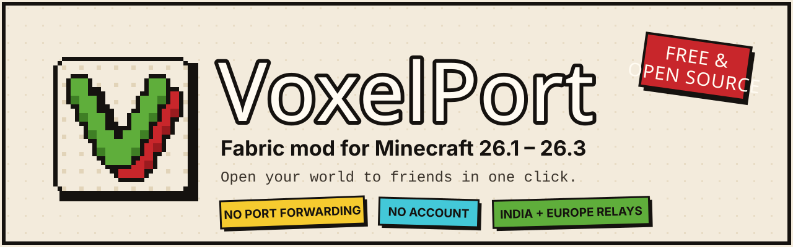
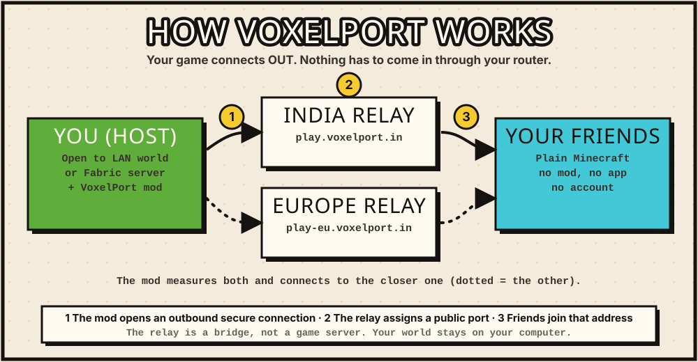

<p align="center">
  
</p>

<p align="center">
  <a href="https://github.com/VOXELPORT/VoxelPort/releases/latest"></a>
  <a href="https://github.com/VOXELPORT/VoxelPort/releases"></a>
  <a href="https://voxelport.in/status"></a>
  <a href="https://discord.gg/JAUfmey2fP"></a>
  <a href="LICENSE"></a>
</p>

<h3 align="center">
  Open your Minecraft world or Fabric server to friends. They join with plain Minecraft.<br />
  No port forwarding · no signup · a friendly <a href="https://discord.gg/JAUfmey2fP">Discord</a> if you want help.
</h3>

<p align="center">
  <a href="https://github.com/VOXELPORT/VoxelPort/releases/latest"></a>
</p>

<p align="center"><sub>Minecraft 26.1 – 26.3 · Fabric Loader 0.18.6+ · Java 25+ · <a href="https://voxelport.in">voxelport.in</a></sub></p>

---

## ⚡ Zero to online in four steps

| | |
|:-:|---|
| **1** | **Download** the latest `VoxelPort-<version>.jar` from the [Releases page](https://github.com/VOXELPORT/VoxelPort/releases/latest) and drop it in your Fabric `mods` folder. |
| **2** | **Open** your world and use Minecraft's **Open to LAN**. |
| **3** | Press **Esc**, then **Open to VoxelPort**. The address is copied, for example `play.voxelport.in:26137` (India) or `play-eu.voxelport.in:26137` (Europe). |
| **4** | Friends paste it into **Multiplayer → Add Server**. Done. |

Running a **dedicated Fabric server** instead? Put the jar in `mods/`, start the server and run `/voxelport start`.

## 🗺️ How it works

<p align="center">
  
</p>

## ✨ What you get

- 🌍 **No port forwarding**: the mod dials out to a relay, so your router and home IP stay private.
- 🎮 **Vanilla clients**: your friends need nothing but Minecraft. Only the host installs the mod.
- 🇮🇳🇪🇺 **Two relay regions**: India (`play.voxelport.in`) and Europe (`play-eu.voxelport.in`). The mod measures both and picks the closer one for lower ping.
- 🖱️ **One click**: **Open to VoxelPort** in the pause menu starts sharing, copies the address and turns into **VoxelPort: Live**.
- 📺 **Live screen**: address, uptime and connected players, with the relay ping in the player-list header (Tab).
- 🖥️ **Dedicated servers too**: `/voxelport start`, `status` and `stop`. No config needed.
- 📣 **Relay announcements**: if the relay is about to restart, you see it on the Live screen and in the log.
- 🔒 **No account**: a private device token is created on first use. Nothing to sign up for, copy or paste.
- 🧩 **One jar for every 26.x**: the same file runs on Minecraft 26.1, 26.1.1, 26.1.2, 26.2 and 26.3.
- 💚 **Free & open source**: MIT-licensed, like the [relay](https://github.com/VOXELPORT/relay).

## 🧰 Commands

`/voxelport` also works as `/voxel` and `/vp`. They need game-master permissions (operator level 2).

| Command | What it does |
|---|---|
| `/voxelport start` | Go public using the server's own port |
| `/voxelport start <port>` | Go public with a different local port |
| `/voxelport status` | Show the address, uptime, players and relay ping |
| `/voxelport stop` | Stop sharing |

## ❓ FAQ

<details>
<summary><b>Do my friends need the mod?</b></summary>

No. They join with normal Minecraft: Java Edition using the address VoxelPort gives you.
</details>

<details>
<summary><b>Which Minecraft versions work?</b></summary>

26.1, 26.1.1, 26.1.2, 26.2 and 26.3 with Fabric Loader 0.18.6 or newer, on Java 25 or newer. When a new Minecraft version moves something the mod hooks into, the mod needs an update, so grab the newest release.
</details>

<details>
<summary><b>Does my game have to stay open?</b></summary>

Yes. The address works while your world or server is running. VoxelPort is not a 24/7 host, and the relays are run by one student with no uptime guarantee, so check the [status page](https://voxelport.in/status) if something looks wrong. For a server that never sleeps, use a paid host.
</details>

<details>
<summary><b>Where is my world stored?</b></summary>

On your computer. The relay only passes traffic along: it is a bridge, not a game server, and it never stores your world or player data.
</details>

<details>
<summary><b>It doesn't connect. What should I check?</b></summary>

Allow outbound HTTPS/WSS to `relay.voxelport.in` and `eu.voxelport.in` on port 443 (India is also tried directly on `direct.voxelport.in:26499`). Make sure your world or server is still running, and that friends use the exact address on the Live screen or in `/voxelport status`.
</details>

<details>
<summary><b>Can I use my own relay or token?</b></summary>

Yes, but most people never need to. Settings live in `config/voxelport/settings.properties`:

```properties
server_token=vp_...        # created for you; keep it private
public_host=play.voxelport.in
server_host=127.0.0.1
max_connections=200
relay_url=wss://relay.voxelport.in
```

With `relay_url` blank (or the default) and `public_host` left as `play.voxelport.in`, the mod picks India or Europe for you. If you set either to something else, such as a self-hosted relay, it uses exactly what you wrote and does no region picking. To use your own token, set the `VOXELPORT_TOKEN` environment variable before starting the server: it overrides the saved token and is never written to disk.
</details>

## 📖 Full guide

Step-by-step install and troubleshooting: **[voxelport.in/guides/voxelport-fabric-mod-install-guide](https://voxelport.in/guides/voxelport-fabric-mod-install-guide)**

## 🖥️ Want more than a mod?

The **[VoxelPort app](https://github.com/VOXELPORT/VoxelPort-App)** hosts any Minecraft server (Java and Bedrock, modpacks, friends-only) without a mod. Get it from the [Microsoft Store](https://apps.microsoft.com/detail/9NGRX9CFNBD6) or [GitHub](https://github.com/VOXELPORT/VoxelPort-App/releases/latest), and the Android app from [voxelport.in](https://voxelport.in).

## 🛠️ For developers

```bash
./gradlew build    # builds build/libs/VoxelPort-<version>.jar and runs the tests
./gradlew test     # unit tests only
```

Needs Java 25. To try another Minecraft version, pass it on the command line: `./gradlew build -Pminecraft_version=26.3`. Releases are built by GitHub Actions when a `v*` tag is pushed.

---

<p align="center">
  <sub>Not affiliated with Mojang or Microsoft. Minecraft is a trademark of Mojang AB.<br />Made by <a href="https://github.com/trazhub">trazhub</a> · <a href="https://voxelport.in">voxelport.in</a></sub>
</p>
